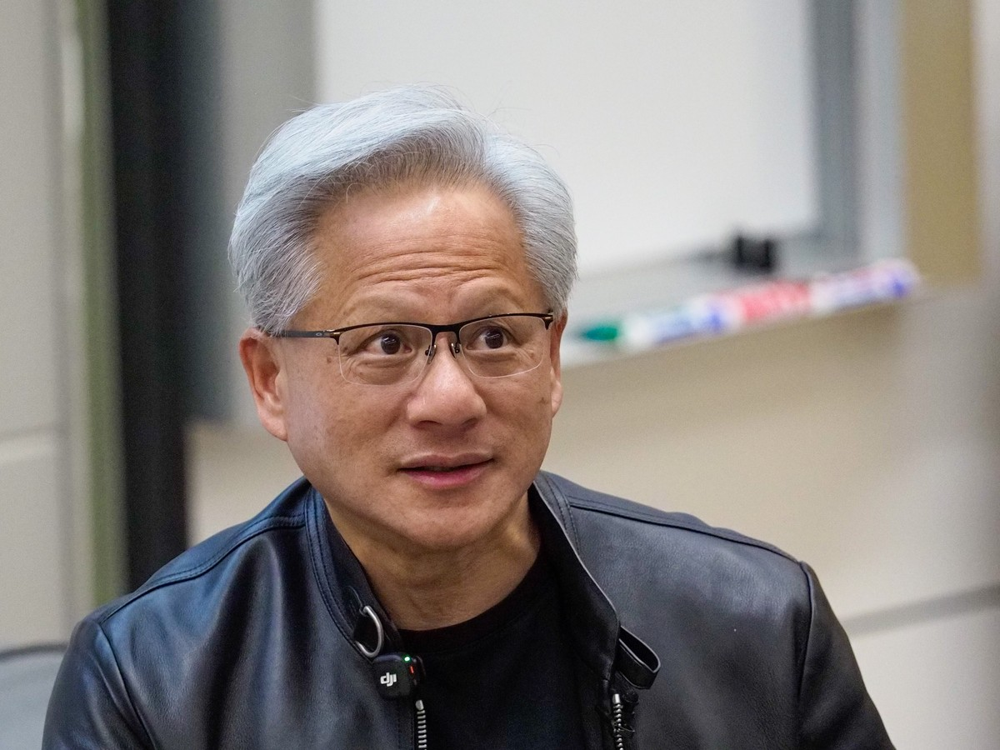
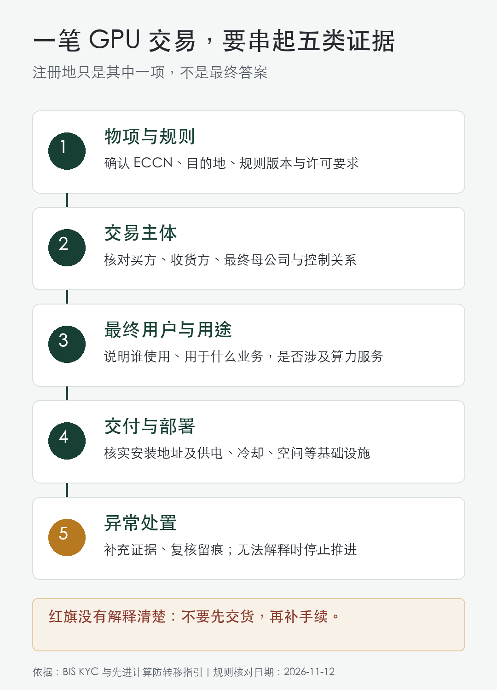

# 黄仁勋风波之外，GPU采购真正该看清的是这道合规关

一张号称“简单解释 GPU 采购流程”的截图，最近被反复转发。

截图里有 KYC、T3 表、国家分档、第三地机房，还有黄仁勋的私人关系。每一段都说得很确定，最后又顺势推出一个“这条路必死”的结论。

如果你负责 GPU 采购、海外算力或数据中心合作，真正难办的不是吃瓜，而是：这些话里，哪些能拿去做判断，哪些必须停下来补证？

我读完最明显的感受，不是它知道得太多，而是它把公开规则、企业内部流程和匿名传闻，压成了同一种确定口吻。合规判断恰恰不能这样做。

> GPU 合规不是一张表、一个注册地或一层内部关系，而是一条持续可核验的证据链。

## 先把已经确认的事，和还在调查的事分开

截至 2026 年 11 月 12 日，有几件事可以从英伟达和美国国会的公开页面直接确认。

11 月 8 日，黄仁勋在发给员工的公开信中承认对婚姻不忠，向家人和同事道歉，并表示会配合董事会调查。这封信没有承认情报活动、违规交易或泄露公司秘密。

同一天，英伟达董事会宣布启动独立调查，由独立董事委员会和外部独立法律顾问监督。董事会同时表示，目前没有理由相信国家安全或英伟达秘密已被泄露。11 月 10 日，独立董事进一步宣布聘请外部法律顾问开展调查。

另外，美国众议院三个委员会主席在 11 月 6 日公开了一封信，请求黄仁勋于 11 月 18 日参加联合闭门简报。这是简报请求，不应被改写成已经出席、刑事传唤，更不是调查结论。

所以，现阶段能说的是：**公司治理和国家安全审查正在发生。**不能说的是：某项违法指控已经成立，或者某笔交易已经因为私人关系被证明违规。

*黄仁勋在斯坦福大学公开活动中讲话，2026 年 4 月。摄影：Anders Eidesvik，来源：Wikimedia Commons，CC BY-SA 4.0；本文做了裁切与压缩。*

## KYC 的核心，不是记住一个表名

截图最容易让人记住的一句话是：“所有 GPU 采购，必须提交一个 KYC，学名是 T3 表。”

我核查了英伟达公开资料和 BIS 文件，没有找到支持这项普遍说法的公开依据。没有公开证据，不代表某个企业或渠道内部一定没有 T3 表；但在拿不到原件、适用范围和版本之前，不能把它说成适用于所有 GPU 采购的统一规则。

公开规则真正强调的内容，反而没有这么神秘。

美国商务部工业与安全局（BIS）的《了解你的客户》指引，要求企业关注最终用途、最终用户、最终目的地，以及交易中出现的异常信号。针对先进计算芯片，BIS 又进一步列出客户成立时间、所有权和最终母公司、最终用户与用途、交付及安装地址、数据中心基础设施等尽调事项。

换句话说，KYC 不是把客户名称填进表格就结束，而是要能回答：谁在购买，谁实际控制，设备交给谁，在哪里使用，用来做什么，回答之间是否相互矛盾。

一张表格可以承载这些信息，但不能替代这些信息。

## 国家组不能简化成“A 好、D 坏”

截图另一个看起来很专业的说法，是把国家分成 A、B、C、D 四档，再把新加坡和马来西亚分别放进“A 类”和“D 类”。

这与当前公开的 EAR 国家组表格并不一致。

EAR 的国家组包括 A、B、C（保留）、D、E，A 和 D 下面还有不同子组，对应不同管制安排。当前表格中，新加坡列入 A:6 和 B 组，马来西亚列入 B 组，并未列入 D 组；中国则出现在 D:1、D:3、D:4 和 D:5。

因此，截图把马来西亚直接称为 D 类，至少与公开表格不符。

更重要的是，国家组不是一张“友好程度排行榜”。一笔交易是否需要许可，还要结合物项分类（ECCN）、目的地、最终用户、最终用途和具体条款。仅凭“A 类容易、D 类特殊审批”去推断整笔交易，很容易把内部风控口径、法律分类和个人解释混为一谈。

对普通团队来说，最稳妥的做法不是背一张来历不明的分档图，而是保存交易发生时有效的规则版本和判断依据。

## 跨境机房真正要回答的是这些问题

“新加坡公司，加上马来西亚机房，到底合不合规？”

这个问题不能靠两个地名回答。注册地和机房所在地当然重要，但它们都不是充分条件。

按照 BIS 的公开指引，至少要继续核对：买方及最终母公司的总部和控制关系，最终用户是谁，具体用途是什么，设备实际交付和安装在哪里，数据中心是否具备相应供电、冷却与空间条件。如果涉及算力服务，还要评估服务对象和用途是否触发当时有效的具体限制。

这里也要避免另一个极端：跨境部署并不天然等于违规，远程使用算力也不能脱离具体规则一概而论。合规工作要做的是把事实查清，而不是先给某个国家或商业模式贴标签。

同样，设备是否搬迁过，本身既不自动证明违规，也不会自动消除风险。如果最终安装地址说不清、客户拒绝披露最终母公司、申报用途与业务背景明显不匹配，这些恰恰是需要解释的异常信号。

异常不会因为换了一个地点就消失。

## 人物关系不是合规流程的替代品

截图把“搞定内部关系”写成通过审批的关键，这既没有公开证据支持，也从根上误解了合规流程。

BIS 的指引中有一条很值得管理者注意：不要“自我蒙眼”。企业不能刻意切断正常业务中流向自己的信息，假装不知道实际最终用户、用途或目的地；员工掌握的信息，在一定条件下还可能被归属于公司。

这意味着，销售听到了什么，渠道发现了什么，管理层收到了什么，不能永远停留在各自聊天记录里。异常信息需要进入同一条升级和复核路径。

真正稳健的流程，不是假设“有人能解释一切”，而是假设任何人都可能遇到自己解释不了的异常，并且有义务把它交给能够处理的人。

## 普通团队可以先做这五项复核

不是每家公司都有专职出口管制团队。但一笔重要交易在继续推进前，至少可以先做下面五项基础复核。

1. **保存一份规则快照。**写清物项及 ECCN、目的地、查询日期、适用条款和许可判断，不拿旧截图替代当前规则。
2. **画出交易主体关系。**列明买方、收货方、最终用户、最终母公司及实际控制关系；关键主体不清，不用“客户没提”代替核查。
3. **把用途写到可验证。**区分自用、转售和提供算力服务，说明谁使用、用于什么业务，避免只写“计算”或“研发”。
4. **核对交付与部署。**确认交付、安装地址和数据中心条件；必要时取得书面声明，并考虑现场或独立第三方核验。
5. **给每个异常一个关闭动作。**记录负责人、补充材料、复核结论和日期。异常仍无法解释时，停止推进，咨询专业人员或按规则联系 BIS，而不是先交货再补手续。

这五步不能保证所有交易都没有风险，但能让团队知道自己在依据什么推进，也知道什么时候应该停下来。

## 最后

那张截图最值得保留的，是它提出了一个问题：GPU 买到手之后，企业是否真的知道它在哪里、由谁使用？

最应该删掉的，则是那些没有来源的确定结论。

人物调查有调查的程序，交易合规有交易的证据。两者可能相关，却不能互相代替。对普通采购和技术团队来说，真正危险的不是少记住一个表名，而是把传闻当结论，把注册地当答案，把表格当护身符。

能把证据链讲清楚，能在异常没有解释时停下来，比记住任何一句“内部流程”都更有用。

---

*本文依据截至 2026 年 11 月 12 日的公开资料整理，仅作一般合规信息分享，不构成法律意见。具体交易应核对当时有效的规则，并咨询具备相应资质的专业人员。*

**资料来源**

- [NVIDIA：黄仁勋致员工信，2026-11-08](https://nvidianews.nvidia.com/news/a-message-to-our-company)
- [NVIDIA：董事会独立调查声明，2026-11-08](https://nvidianews.nvidia.com/news/statement-from-nvidia-board-of-directors)
- [NVIDIA：独立董事会成员聘请外部顾问声明，2026-11-10](https://nvidianews.nvidia.com/news/statement-from-the-independent-members-of-the-nvidia-board)
- [美国众议院外交事务委员会：闭门简报请求，2026-11-06](https://foreignaffairs.house.gov/news/press-releases/chairmen-mast-moolenaar-and-crawford-request-jensen-huang-brief-congress-on-link-to-chinese-intelligence-asset)
- [BIS：《了解你的客户》指引与异常信号](https://www.bis.gov/node/1533)
- [BIS：先进计算集成电路防转移行业指引，2025-05-13](https://www.bis.gov/media/documents/ai-counter-diversion-industry-guidance-may-13-2025.pdf)
- [EAR 国家组：eCFR 官方入口](https://www.ecfr.gov/current/title-15/subtitle-B/chapter-VII/subchapter-C/part-740/appendix-Supplement%20No.%201%20to%20Part%20740)；[Cornell LII 文本镜像](https://www.law.cornell.edu/cfr/text/15/appendix-Supplement_No_1_to_part_740)
- 人物原图：[Wikimedia Commons](https://commons.wikimedia.org/wiki/File:Jensen_huang_stanford_2026-04-30_008.jpg)，Anders Eidesvik，[CC BY-SA 4.0](https://creativecommons.org/licenses/by-sa/4.0/)。本文裁切、压缩并用于封面排版，改编图片按同一许可分享。
